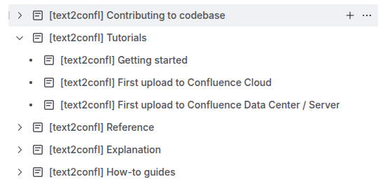

# text2confl - publish Markdown & AsciiDoc to Confluence

[](https://hub.docker.com/r/zeldigas/text2confl)
[](https://github.com/zeldigas/text2confl/releases/latest)
[](LICENSE)
[](https://github.com/zeldigas/text2confl/actions/workflows/build.yml)
<!-- Once the chat exists: [](https://text2confl.zulipchat.com) -->

**Keep your docs in git. Let your colleagues read them in Confluence.**

`text2confl` turns a folder of Markdown and/or AsciiDoc files into a Confluence page tree - on **Confluence Cloud** and **Server / Data Center** - and keeps it in sync from your laptop or CI.

Your team writes and reviews documentation like code: in pull requests, next to the code it describes. Everyone else
reads it where they already are - Confluence. No copy-pasting, no stale wiki pages, no fighting the WYSIWYG editor.

```text
docs/                                   Confluence space
├── architecture.md          ──►        ├── Architecture
├── architecture/                       │   ├── Services
│   ├── services.md                     │   └── Data flow
│   └── data-flow.adoc                  └── Runbooks
├── runbooks.md                             └── Incident response
└── runbooks/
    └── incident-response.md
```

<!-- TODO: a side-by-side screenshot (Markdown source | rendered Confluence page) -->

## Quick start

Publish a folder of docs with Docker - nothing else to install:

```shell
docker run --rm -v "$PWD:/wd" --workdir /wd \
  -e CONFLUENCE_username=<your email> \
  -e CONFLUENCE_PASSWORD=<your token> \
  zeldigas/text2confl upload --docs ./docs \
    --confluence-url https://yoursite.atlassian.net/wiki \
    --space DOCS --parent "Engineering docs"
```

Run it again after editing - only changed pages are updated. Prefer a native binary? Grab one from
[Releases](https://github.com/zeldigas/text2confl/releases/latest).

**Step-by-step first upload:** [Confluence Cloud](docs/tutorials/first-upload-cloud.adoc) ·
[Confluence Data Center / Server](docs/tutorials/first-upload-dc.adoc)

## Features

**Formats and structure**

- ✅ **Markdown** and **AsciiDoc** - even mixed in one documentation set
- ✅ Folder structure becomes the page tree (`foo.md` + `foo/` → page with children)
- ✅ Relative links between files (including `#anchors`) become links between Confluence pages
- ✅ Images and other files uploaded as page attachments
- ✅ AsciiDoc includes; Markdown YAML front matter for titles, labels and page properties

**Content**

- ✅ Diagrams as code: **PlantUML**, **Mermaid**, **Kroki** (and `asciidoctor-diagram` for AsciiDoc)
- ✅ Admonitions - **GitHub alerts** (`> [!NOTE]`) and `!!! tip` style - rendered as Confluence info/tip/note/warning panels
- ✅ Code blocks with syntax highlighting and titles
- ✅ Tables, including complex tables, column widths and cell background colors
- ✅ Table of contents, status labels, user mentions, dates, expand blocks, emoji
- ✅ **Any Confluence macro** with a one-liner - e.g. `[JIRA jqlQuery="project = SI"]` for a live Jira table - plus raw storage format when you need it

**Safe for real-world spaces**

- ✅ Change detection - unchanged pages aren't re-uploaded
- ✅ Orphan cleanup - pages whose source was deleted are removed (only pages text2confl created, by default)
- ✅ **Virtual pages** - manage a few pages as code inside a hand-crafted tree, without taking over the whole space
- ✅ **Multi-tenancy** - several teams or pipelines can publish under the same parent without deleting each other's pages
- ✅ Dry run, and `doctor confluence` to check connectivity and every permission before the first upload

**Getting in and out**

- ✅ Official **Docker image** for CI/CD (GitHub Actions, GitLab CI, Jenkins…)
- ✅ Personal access tokens, API tokens and Cloud **scoped tokens**
- ✅ `export-to-md` - pull an existing Confluence page down as Markdown to start your docs-as-code migration

## Documentation

**Doing a specific task?**

- 🔒 [Authenticate with Confluence](docs/how-to/authenticate.md) · [Scoped tokens (Cloud)](docs/how-to/authenticate-with-scoped-tokens.md)
- ⬆️ [Ad-hoc upload](docs/how-to/upload-adhoc.md) · [Run with Docker / in CI](docs/how-to/run-with-docker.md)
- ⬇️ [Export a Confluence page to Markdown](docs/how-to/export-to-markdown.md)
- 📁 [Use virtual pages](docs/how-to/use-virtual-pages.md) · [Manage orphaned pages](docs/how-to/manage-orphaned-pages.md)
- 🏢 [Configure multi-tenancy](docs/how-to/configure-multi-tenancy.md)
- 🩺 [Diagnose access with `doctor`](docs/how-to/troubleshoot-with-doctor.md) · [Troubleshoot conversion](docs/how-to/troubleshoot-conversion.md)

**Looking up options?**

- ⚙️ [Configuration reference](docs/reference/configuration.adoc)
- 📝 [Markdown syntax](docs/reference/markdown.md) · 📜 [AsciiDoc syntax](docs/reference/asciidoc.adoc)
- 📄 [Page attributes](docs/reference/page-attributes.md) · [Image attributes](docs/reference/image-attributes.md) · [Code blocks](docs/reference/code-blocks.adoc)

**Want to understand how it works?**

- 🔍 [How publishing works](docs/explanation/how-publishing-works.md)
- 📚 [Storage formats](docs/explanation/storage-formats.md) - Markdown vs AsciiDoc
- 🧠 [Change detection strategies](docs/explanation/change-detection.md)

## See it on real docs

This repo's own `docs/` folder is a working example - publish it to a test space to see every feature rendered:

```shell
# from the root of the checked out text2confl repo
text2confl upload --docs ./docs \
  --confluence-url https://wiki.example.org \
  --access-token <your token> \
  --space DOCS \
  --parent "Text2Confl test"
```



> No public demo space yet: Confluence Cloud's free tier can't publish to non-members. If you can sponsor a read-only
> showcase space, please open an issue.

## Questions and contributing

- 💬 Questions and ideas: [Discussions](https://github.com/zeldigas/text2confl/discussions)
  <!-- swap for the chat link once it's set up -->
- 🐞 Bugs and missing features: [open an issue](https://github.com/zeldigas/text2confl/issues) - the scope isn't
  fixed, so if your use case needs something, describe it
- 🤝 [Contributing guide](CONTRIBUTING.md) · [Contribution notes](docs/contributing.md)

## Who's using text2confl

Using it at work? Add your company or project with a PR, or open an issue/message me and I'll add it for you.
Real-world names are the strongest signal for the next team evaluating the tool.

- *Your company / project*

---

If text2confl saves you time, a ⭐ helps other teams find it.
