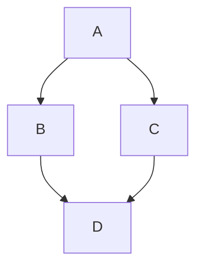

# Markdown - Diagrams

**text2confl** supports a number of text diagram formats to be embedded in Confluence page as code blocks:

* [PlantUML](https://plantuml.com/en/)
* [Mermaid](https://mermaid.js.org/)
* [Kroki](https://kroki.io/)

By default, **text2confl** provides zero-configuration support lookup for every type of supported diagram is detected in
runtime during startup. If detection failed to verify that external tool is present then support is turned off and code
blocks remains simple code blocks.

Generated diagrams are attached to page like a regular files.

## Name generation

As every diagram is translated to a separate page attachment, you have two options to control its name:

* explicitly specify it using `target` code block attribute. This is a recommended approach because it provides
  consistent naming
  when changing diagram content
* use automatically generated names based on code block content. In this case attachment name is equal to sha256 hash of
  content.

## Location where diagrams are generated

By default, generated diagrams are saved in `.diagrams` directory under document's root.

This is configurable with the following parameters in `.text2confl.yml` file

```yaml
markdown:
  diagrams:
#  parameters here
```

| name       | description                                                                                       | default value |
|------------|---------------------------------------------------------------------------------------------------|---------------|
| `base-dir` | Base directory to store diagrams. Relative path is resolved from directory with `.text2confl.yml` | `.diagrams`   |
| `temp-dir` | Use random temporary directory instead of `base-dir`                                              | `false`       |

## Caching

Generated diagrams are cached to avoid sequential regenerations. If diagram script or provided conversion attributes
are changed, it will be regenerated.

Right now there is no option to force diagrams regeneration, but removing directory with diagrams or particular
`*.cache` file in `base-dir`.

## Rendering diagrams as Confluence macros

If your Confluence has an app that renders diagrams from source right on the page, **text2confl** can put diagram
source into the app's macro instead of generating an image. Diagram keeps its source and stays editable in Confluence,
no local tool or Kroki server is needed and no attachment is uploaded.

Macros are configured in named groups. Each group lists code block languages in `formats` and defines Confluence
storage format markup in `template`. Template is a [Mustache](https://mustache.github.io/mustache.5.html) template
with the following variables:

| variable                            | value                                                                                   |
|-------------------------------------|-----------------------------------------------------------------------------------------|
| `{{lang}}`                          | Code block language, e.g. `mermaid`. XML-escaped                                        |
| `{{source}}`                        | Diagram source, XML-escaped                                                             |
| `{{{source}}}`                      | Diagram source as is                                                                    |
| `{{#cdata}}{{{source}}}{{/cdata}}`  | Diagram source wrapped in `<![CDATA[...]]>`. `]]>` in the source is split so that it doesn't end the section |

```yaml {title=.text2confl.yml}
markdown:
  diagrams:
    macros:
      some-diagram-app:
        formats: [ puml, plantuml ]
        template: >-
          <ac:structured-macro ac:name="some-diagram-macro">
          <ac:parameter ac:name="language">{{lang}}</ac:parameter>
          <ac:plain-text-body>{{#cdata}}{{{source}}}{{/cdata}}</ac:plain-text-body>
          </ac:structured-macro>
```

Example for Forge based Macro Pack app in Confluence Cloud, where `<app-id>/<environment-id>` part of extension key is
specific to your site. YAML anchor lets to reuse the same template for Mermaid and PlantUML, and `{{lang}}` is passed
to the app as diagram type, so each group lists only the language name the app expects:

```yaml {title=.text2confl.yml}
x-templates:
  macro-pack: &macro-pack >-
    <ac:adf-extension><ac:adf-node type="extension">
    <ac:adf-attribute key="extension-key"><app-id>/<environment-id>/static/macro-pack</ac:adf-attribute>
    <ac:adf-attribute key="extension-type">com.atlassian.ecosystem</ac:adf-attribute>
    <ac:adf-attribute key="parameters">
    <ac:adf-parameter key="layout">extension</ac:adf-parameter>
    <ac:adf-parameter key="guest-params">
    <ac:adf-parameter key="input">{{lang}}</ac:adf-parameter>
    <ac:adf-parameter key="source">
    <ac:adf-parameter key="text">{{#cdata}}{{{source}}}{{/cdata}}</ac:adf-parameter>
    <ac:adf-parameter key="type">text</ac:adf-parameter>
    </ac:adf-parameter>
    <ac:adf-parameter key="version">1</ac:adf-parameter>
    </ac:adf-parameter>
    </ac:adf-attribute>
    <ac:adf-attribute key="text">Macro Pack</ac:adf-attribute>
    <ac:adf-attribute key="layout">default</ac:adf-attribute>
    </ac:adf-node></ac:adf-extension>
markdown:
  diagrams:
    macros:
      mermaid:
        formats: [ mermaid ]
        template: *macro-pack
      plantuml:
        formats: [ plantuml ]
        template: *macro-pack
```

Things to keep in mind:

* Macros take precedence over diagram generators, but only for listed formats. A format can be listed in one group
  only.
* Code block attributes like `target` or `format` are not used.
* Template syntax is checked before conversion starts, unknown variable fails conversion of the page. Diagram source
  is not validated, errors are visible only on rendered page.
* Diagram is displayed only if corresponding app is installed in Confluence. Rendering limitations of the app apply,
  e.g. Mermaid in Macro Pack doesn't display `<` and `>` in node labels.

## Formats

### PlantUML

Code block language tags: `plantuml`, `puml`

<table>
<thead>
<tr><th>Markdown</th><th>Confluence</th></tr>
</thead>
<tbody><tr>
<td>

````markdown
```puml
!theme carbon-gray
Bob->Alice : Hello!
```

{target=puml-sample}
````

</td><td>

```puml
!theme carbon-gray
Bob->Alice : Hello!
```

{target=puml-sample}

</td></tr></tbody></table>

PlantUML is bundled in **text2confl** Docker image.

Supported code-block attributes:

* `target` - base name for generated image _without extension_
* `format` - what format to use for this diagram. Allowed values - `png`, `svg`
* `theme` - plantuml theme to use for rendering. Passed as `-theme` cli option

#### Generator configuration

PlantUML parameters can be specified in `.text2confl.yml` file:

```yaml {title=.text2confl.yml}
markdown:
  diagrams:
    plantuml:
#      parameters here
```

| name             | description                                                                                                                                                                                                                                     | default value |
|------------------|-------------------------------------------------------------------------------------------------------------------------------------------------------------------------------------------------------------------------------------------------|---------------|
| `enabled`        | Enable PlantUML diagrams support                                                                                                                                                                                                                | `true`        |
| `executable`     | Command name to invoke for plantuml. There is no support for invoking a jar with `java -jar`, so you need to have a wrapper script that will do it and pass all arguments down. Relative path is resolved from directory with `.text2confl.yml` | `plantuml`    |
| `default-format` | Format to use for generated images. Available options: `svg`, `png`                                                                                                                                                                             | `png`         |

### Mermaid

Code block language tags: `mermaid`

<table>
<thead>
<tr><th>Markdown</th><th>Confluence</th></tr>
</thead>
<tbody><tr>
<td>

````markdown


{target=mermaid-sample}
````

</td><td>


{target=mermaid-sample}

</td></tr></tbody></table>

Mermaid is not bundled with **text2confl** Docker image by default, so you can create a derivative image with it or use
a non-docker version with locally installed mermaid-cli.

Supported code-block attributes:

* `target` - base name for generated image _without extension_
* `format` - what format to use for this diagram. Allowed values - `png`, `svg`

!!! warning

    mermaid generates non-reproducible svg files, they contain a unique identifier that is always different.
    This will force attachment to be always reuploaded

#### Generator configuration

Mermaid parameters can be specified in `.text2confl.yml` file:

```yaml {title=.text2confl.yml}
markdown:
  diagrams:
    mermaid:
#      parameters here
```

| name               | description                                                                                                                      | default value                                |
|--------------------|----------------------------------------------------------------------------------------------------------------------------------|----------------------------------------------|
| `enabled`          | Enable Mermaid diagrams support                                                                                                  | `true`                                       |
| `executable`       | Command name to invoke for mermaid. Relative path is resolved from directory with `.text2confl.yml`                              | `mmdc`                                       |
| `default-format`   | Format to use for generated images. Available options: `svg`, `png`                                                              | `png`                                        |
| `config-file`      | Mermaid configuration file to pass for every diagram invocation. Relative path is resolved from directory with `.text2confl.yml` |                                              |
| `css-file`         | Mermaid css file to pass for every diagram. Relative path is resolved from directory with `.text2confl.yml`                      |                                              |
| `puppeeter-config` | Puppeteer configuration file to pass to the mermaid CLI. Relative path is resolved from directory with `.text2confl.yml`          | Value of `T2C_PUPPEETER_CONFIG` env variable |

### Kroki

Kroki provides supports for multiple diagrams as a web service. **text2confl** by default enables support for Kroki and
uses public service for generation - <https://kroki.io>.

Example [Erd](https://github.com/BurntSushi/erd) diagram:

<table>
<thead>
<tr><th>Markdown</th><th>Confluence</th></tr>
</thead>
<tbody><tr>
<td>

````markdown
```erd {target=kroki-erd}
[Person]
*name
height
weight
+birth_location_id

[Location]
*id
city
state
country

Person *--1 Location
```
````

</td><td>

```erd {target=kroki-erd}
[Person]
*name
height
weight
+birth_location_id

[Location]
*id
city
state
country

Person *--1 Location
```

</td></tr></tbody></table>

Supported code-block attributes:

* `target` - base name for generated image _without extension_
* `format` - what format to use for this diagram. Allowed values - `png`, `svg`
* `option_<option_name>` - extra option that will be passed to kroki generation. All options can be found
  in [official docs](https://docs.kroki.io/kroki/setup/diagram-options/). For example `option_size=1000x1000` will pass
  option `size` with value `1000x1000`

#### Generator configuration

Kroki parameters can be specified in `.text2confl.yml` file:

```yaml {title=.text2confl.yml}
markdown:
  diagrams:
    kroki:
#      parameters here
```

| name             | description                                                                                           | default value      |
|------------------|-------------------------------------------------------------------------------------------------------|--------------------|
| `enabled`        | Enable Kroki diagrams support                                                                         | `true`             |
| `server`         | Kroki server                                                                                          | `https://kroki.io` |
| `default-format` | Format to use for generated images. Available options: `svg`, `png`. Some diagrams support only `svg` | `png`              |

#### Supported formats

Kroki supports [more than 20 diagram formats](https://kroki.io/#support), including `plantuml` and `mermaid`. Native
PlantUML and Mermaid generator takes higher precedence, but if you disable them, these formats will be still supported
by Kroki.

Supported diagrams:

| Language codes                                                        | Formats      | Diagram format origin                                        |
|-----------------------------------------------------------------------|--------------|--------------------------------------------------------------|
| `puml`, `plantuml`, `c4plantuml`                                      | `png`, `svg` | [PlantUML](https://plantuml.com/en/)                         | 
| `mermaid`                                                             | `png`, `svg` | [Mermaid](https://mermaid.js.org/)                           | 
| `blockdiag`, `seqdiag`, `actdiag`, `nwdiag`, `packetdiag`, `rackdiag` | `png`, `svg` | [Blockdiag](https://github.com/blockdiag)                    | 
| `umlet`                                                               | `png`, `svg` | [UMlet](https://github.com/umlet/umlet)                      |
| `graphviz`, `dot`                                                     | `png`, `svg` | [GraphViz](https://www.graphviz.org/)                        |
| `erd`                                                                 | `png`, `svg` | [Erd](https://github.com/BurntSushi/erd)                     |
| `svgbob`                                                              | `svg`        | [Svgbob](https://github.com/ivanceras/svgbob)                |
| `nomnoml`                                                             | `svg`        | [nomnoml](https://github.com/skanaar/nomnoml)                |
| `vega`, `vegalite`                                                    | `png`, `svg` | [Vega](https://github.com/vega/vega)                         |
| `wavedrom`                                                            | `svg`        | [Wavedrom](https://github.com/wavedrom/wavedrom)             |
| `bpmn`                                                                | `svg`        | [BPMN](https://github.com/bpmn-io/bpmn-js)                   |
| `bytefield`                                                           | `svg`        | [Bytefield](https://github.com/Deep-Symmetry/bytefield-svg/) | 
| `excalidraw`                                                          | `svg`        | [Excalidraw](https://github.com/excalidraw/excalidraw)       |
| `pikchr`                                                              | `svg`        | [Pikchr](https://github.com/drhsqlite/pikchr)                |
| `structurizr`                                                         | `png`, `svg` | [Structurizr](https://github.com/structurizr/dsl)            |
| `diagramsnet`                                                         | `png`, `svg` | [Diagrams.net](https://www.diagrams.net/)                    |
| `ditaa`                                                               | `png`, `svg` | [Ditaa](https://ditaa.sourceforge.net/)                      |
| `d2`                                                                  | `svg`        | [D2](https://d2lang.com/)                                    |

        